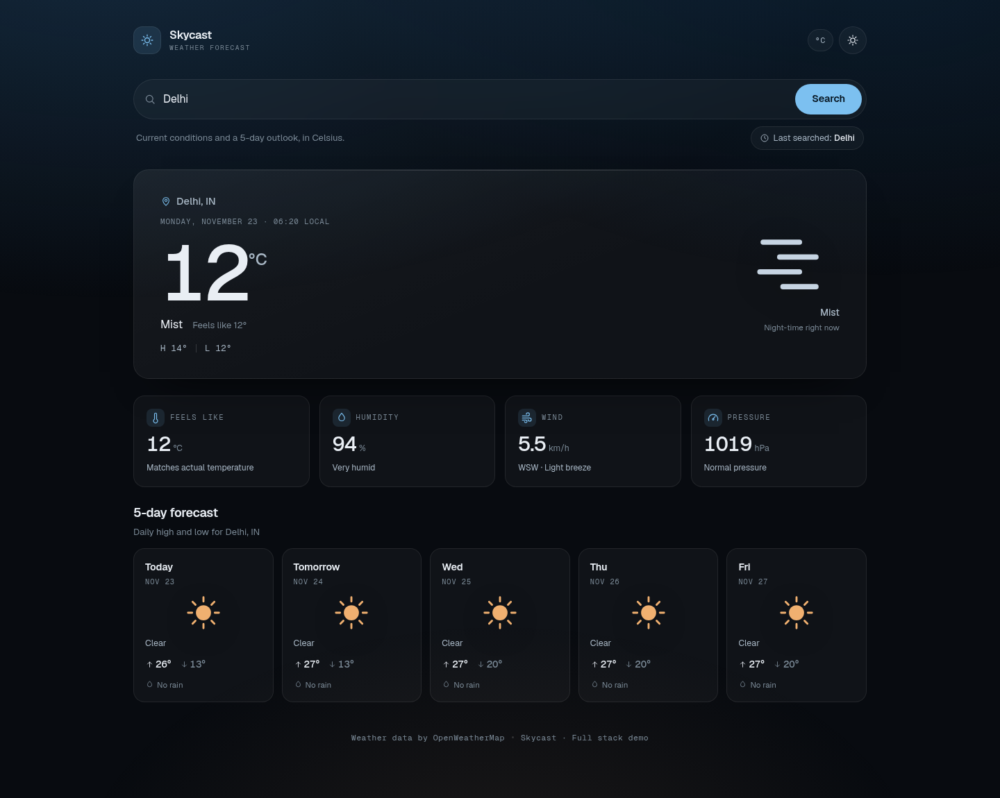
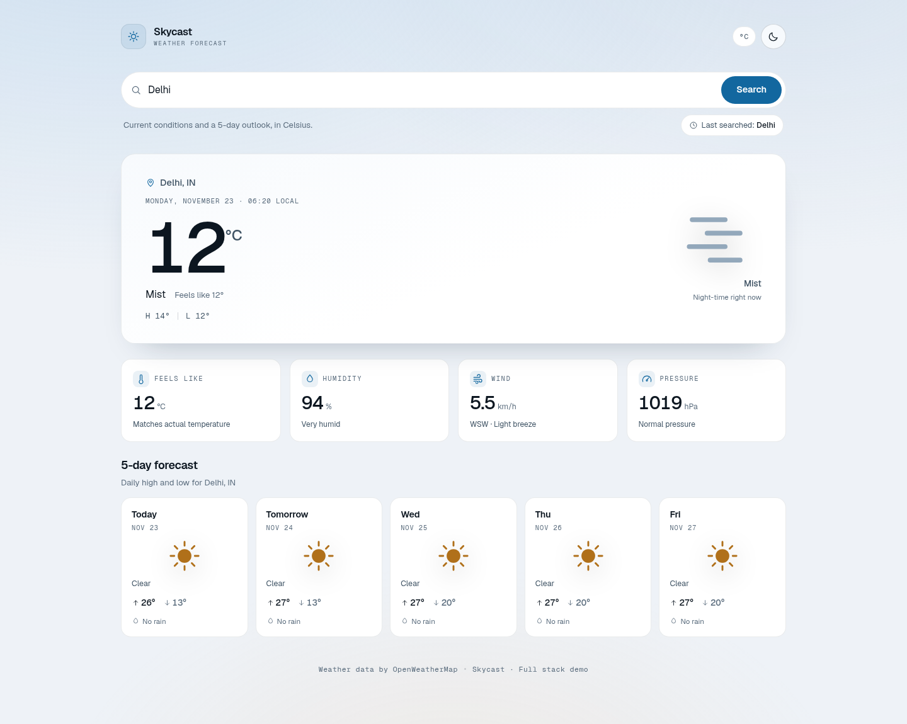
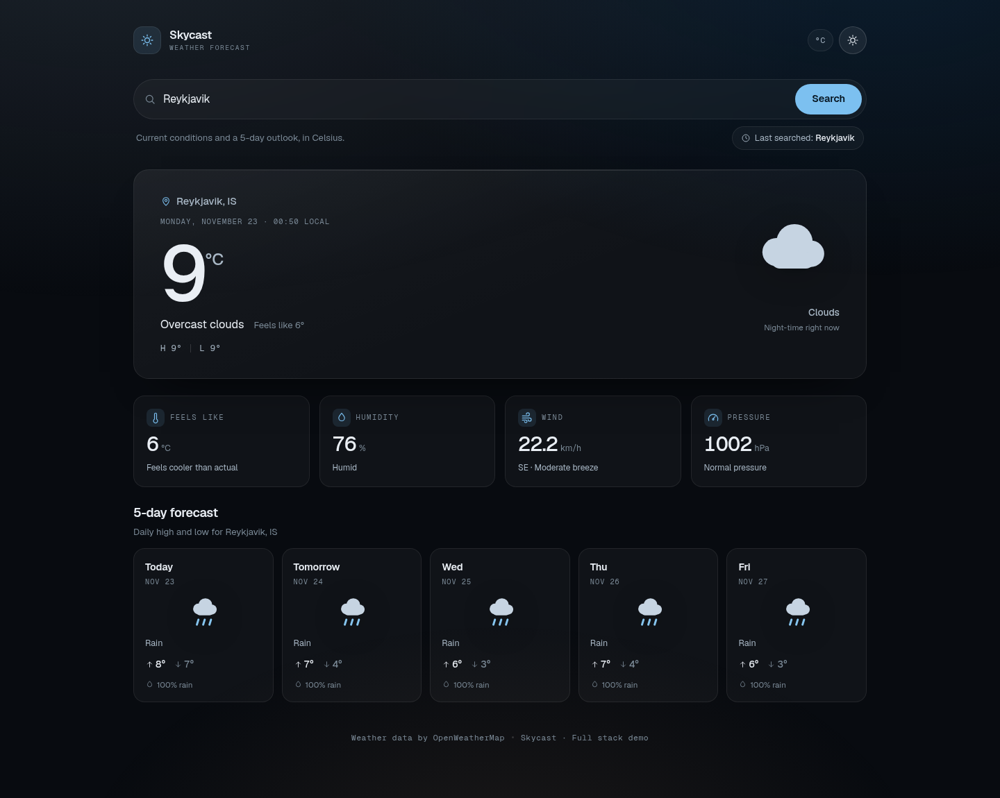
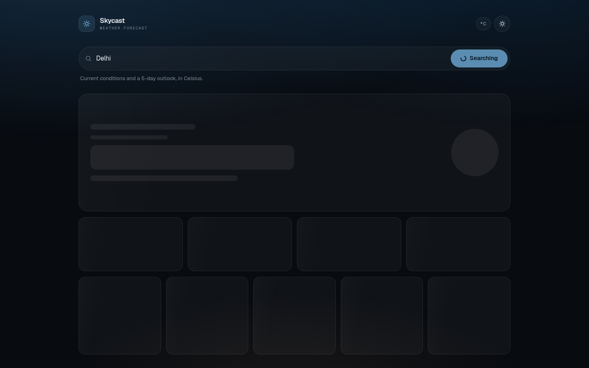
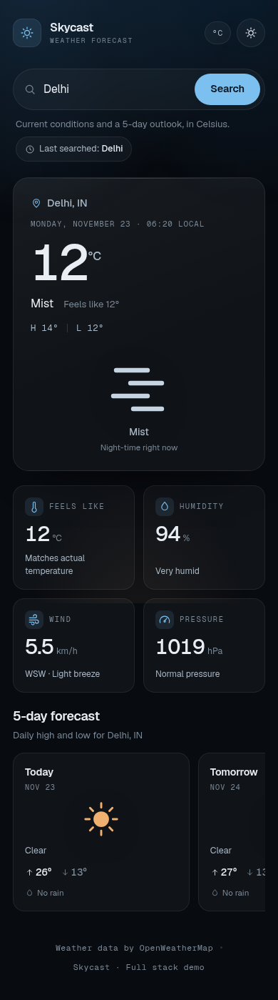
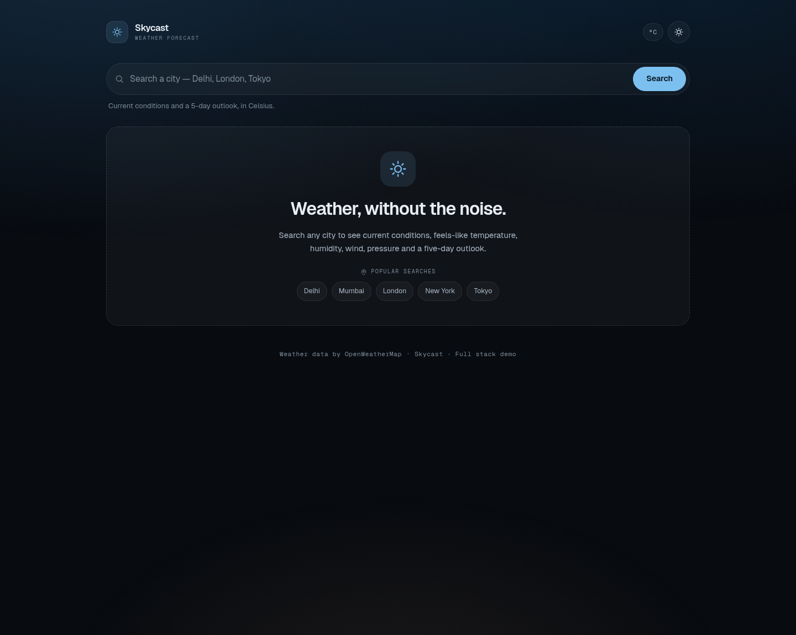
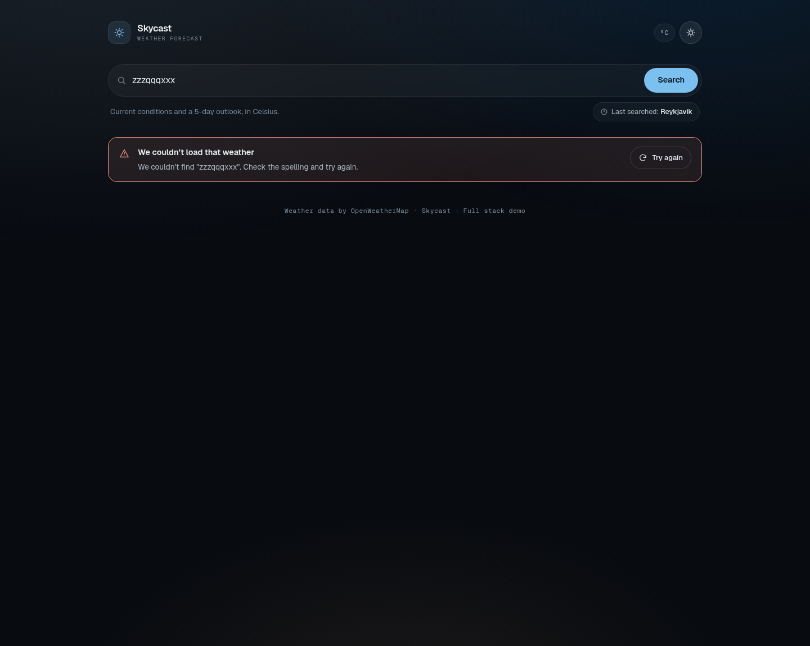

# Skycast — Weather Forecast Application

A complete full-stack weather dashboard built for the **Codec Technologies Full Stack Development Internship**. Search any city to see current conditions, feels-like temperature, humidity, wind, atmospheric pressure, weather glyphs and a 5-day forecast — powered by the OpenWeatherMap API through a secure Express backend proxy.

**Core rule of this architecture:** the browser never talks to OpenWeatherMap and never sees an API key. The React client only calls the Express server; the server holds the key in `.env` and returns clean, normalized JSON.

---

## Features

- Search weather by city name (keyboard `Enter` or the Search button)
- Current conditions: temperature in **Celsius**, **feels-like**, **humidity**, **wind speed** (km/h + direction), **atmospheric pressure** (hPa), condition text and a matching weather glyph
- **5-day forecast** with daily high/low, dominant condition, humidity, average wind and chance of rain
- Local sunrise/sunset context (day / night state) and observation timestamp in the city's local time
- **Last searched city** remembered and auto-restored on reload (one-click re-search chip)
- Polished **dark / light theme** toggle that respects the system preference and persists
- Loading skeletons shaped like the real layout, inline empty-input validation, friendly error banners with retry
- Fully **responsive, mobile-first** layout (single column, 2×2 stat grid, swipeable forecast rail)
- No unnecessary runtime dependencies: React + Express + `cors` + `dotenv` only

## Tech Stack

| Layer | Technology |
| --- | --- |
| Frontend | React 19 (functional components + Hooks), Vite 6, HTML5, CSS3 (custom properties, Grid, Flexbox), JavaScript (ESM) |
| Backend | Node.js ≥ 18, Express 4, native `fetch`, ESM modules |
| External API | OpenWeatherMap — Current Weather Data + 5 Day / 3 Hour Forecast |
| Configuration | `dotenv`, `VITE_API_BASE_URL` for the client |
| Testing | Playwright-driven Chromium (search, states, persistence, responsive checks) |

## Architecture

```
┌──────────────┐   GET /api/weather?city=Delhi   ┌──────────────────┐   /data/2.5/weather    ┌────────────────┐
│ React client │ ───────────────────────────────▶ │  Express server  │ ─────────────────────▶ │  OpenWeatherMap │
│  (Vite dev / │ ◀─────────────────────────────── │  (port 5000)     │ ◀───────────────────── │      API        │
│   static)    │   normalized JSON + friendly err │  key stays here  │   raw JSON            │  (key in .env)  │
└──────────────┘                                  └──────────────────┘                        └────────────────┘
```

- **Client** → `src/services/weatherApi.js` builds URLs from `VITE_API_BASE_URL`, fetches both endpoints in parallel and maps HTTP failures to friendly messages.
- **Server** → `routes` → `middleware/validateCity` → `controllers` → `services/openWeatherService` (upstream fetch + error mapping) → `services/weatherMapper` (normalization) → JSON response.
- **Centralized errors** → every failure becomes an `AppError` with a status code, a user-safe message and a machine-readable `code`; `middleware/errorHandler.js` is the single response formatter. Stack traces are logged to the server console only — never sent to the browser.

## Project Structure

```
weather-forecast/
├── client/
│   ├── index.html
│   ├── package.json
│   ├── vite.config.js
│   ├── .env.example
│   ├── public/favicon.svg
│   └── src/
│       ├── components/
│       │   ├── TopBar.jsx            # brand + theme toggle
│       │   ├── SearchBar.jsx         # input, button, last-searched chip, inline validation
│       │   ├── CurrentWeather.jsx    # hero: city, local time, temp, feels-like, H/L
│       │   ├── WeatherIcon.jsx       # 10 condition-mapped SVG glyphs (no external assets)
│       │   ├── StatsGrid.jsx         # feels-like / humidity / wind / pressure cards
│       │   ├── Forecast.jsx          # 5-day forecast rail
│       │   ├── LoadingState.jsx      # layout-shaped skeletons
│       │   ├── ErrorBanner.jsx       # friendly error + retry
│       │   ├── EmptyState.jsx        # first-run state + popular searches
│       │   └── Icons.jsx             # UI stroke icons
│       ├── services/weatherApi.js    # API base URL, fetch wrapper, error mapping
│       ├── utils/format.js           # dates in city local time, wind/humidity descriptors
│       ├── App.jsx                   # state machine: idle | loading | error | ready
│       ├── App.css / index.css       # layout + design tokens (dark & light)
│       └── main.jsx
├── server/
│   ├── server.js                     # app bootstrap, CORS, health route, graceful shutdown
│   ├── package.json
│   ├── .env / .env.example
│   ├── config/env.js                 # dotenv loading + validated config
│   ├── routes/weatherRoutes.js       # GET /api/weather, GET /api/forecast
│   ├── controllers/weatherController.js
│   ├── services/
│   │   ├── openWeatherService.js     # upstream fetch, timeout, status mapping
│   │   └── weatherMapper.js          # raw OWM payload → clean structured JSON
│   ├── middleware/
│   │   ├── validateCity.js           # query validation
│   │   └── errorHandler.js           # 404 + centralized error formatter
│   └── utils/AppError.js
├── docs/screenshots/                 # README screenshots
├── .env.example
├── .gitignore
├── package.json                      # convenience scripts for both apps
└── README.md
```

## Installation

Prerequisites: **Node.js ≥ 18.17** and npm. An OpenWeatherMap API key (free at [openweathermap.org/api](https://openweathermap.org/api)).

```bash
git clone <your-repo-url> weather-forecast
cd weather-forecast

# install both apps
npm run install:all
# equivalent to:  npm --prefix server install && npm --prefix client install
```

## Environment Variables

Copy the examples and fill in your key. **Real keys are git-ignored — never commit `.env` files.**

```bash
cp .env.example server/.env     # backend (required)
cp client/.env.example client/.env   # frontend (optional in local dev)
```

**Backend — `server/.env`**

| Variable | Required | Default | Purpose |
| --- | --- | --- | --- |
| `OPENWEATHER_API_KEY` | yes | — | OpenWeatherMap key, read only by the server |
| `PORT` | no | `5000` | API server port |
| `NODE_ENV` | no | `development` | `production` for deployed environments |
| `CLIENT_ORIGIN` | no | `http://localhost:5173,http://localhost:4173` | Comma-separated allowed CORS origins |
| `REQUEST_TIMEOUT_MS` | no | `10000` | Upstream request timeout |

**Frontend — `client/.env`**

| Variable | Default | Purpose |
| --- | --- | --- |
| `VITE_API_BASE_URL` | `http://localhost:5000` | Base URL of the backend (no trailing slash) |

If the key is missing, the server still boots, logs a clear warning and answers every weather request with `503` and a friendly message instead of crashing.

## Running the Application

Two terminals, two processes:

```bash
# terminal 1 — backend (http://localhost:5000)
npm run dev:server          # node --watch, auto-restarts on changes
# or production mode:
NODE_ENV=production npm run start:server

# terminal 2 — frontend (http://localhost:5173)
npm run dev:client
```

Open **http://localhost:5173**, search a city (try `Delhi`, `Reykjavik`, `Tokyo`) and press Enter.

### Production build

```bash
npm run build:client        # outputs static site to client/dist
npm run start:server        # API on PORT (default 5000)
```

Preview the built client locally with `npm --prefix client run preview` (serves `client/dist` on port `4173`; that origin is already in the default `CLIENT_ORIGIN`).

## API Documentation

All responses are JSON. Success: `{ "success": true, "data": … }`. Failure: `{ "success": false, "error": { "code", "message" } }`.

### `GET /api/health`

```json
{ "success": true, "data": { "status": "ok", "environment": "development",
  "weatherApiConfigured": true, "uptimeSeconds": 42 } }
```

### `GET /api/weather?city=Delhi`

```json
{
  "success": true,
  "data": {
    "city": "Delhi", "country": "IN",
    "coordinates": { "lat": 28.6667, "lon": 77.2167 },
    "timezoneOffset": 19800,
    "observedAt": 1795390572000,
    "isDay": false,
    "temperature": { "current": 13, "feelsLike": 13, "min": 13, "max": 14, "unit": "C" },
    "humidity": 100,
    "pressure": 1018,
    "wind": { "speedMs": 1.5, "speedKmh": 5.5, "gustKmh": null,
              "directionDeg": 250, "direction": "WSW" },
    "condition": { "id": 701, "main": "Mist", "description": "mist", "icon": "50n" },
    "clouds": 0, "visibilityKm": 1.4,
    "sunrise": 1795396807000, "sunset": 1795434906000
  }
}
```

`observedAt` / `sunrise` / `sunset` are epoch milliseconds; add `timezoneOffset` (seconds) to display them in the city's local time.

### `GET /api/forecast?city=Delhi`

The raw 3-hourly feed (40 entries) is grouped into **5 local calendar days**:

```json
{
  "success": true,
  "data": {
    "city": "Delhi", "country": "IN",
    "coordinates": { "lat": 28.6667, "lon": 77.2167 },
    "timezoneOffset": 19800,
    "days": [
      { "date": "2026-11-23", "min": 13, "max": 26, "humidity": 40,
        "windKmh": 8, "precipitationChance": 0,
        "condition": { "id": 800, "main": "Clear",
                       "description": "clear sky", "icon": "01d" },
        "unit": "C" }
    ]
  }
}
```

`days` always contains up to 5 entries; `condition` is the most frequent condition of that day and `icon` is forced to the daytime variant.

### Error responses

| Status | `error.code` | When |
| --- | --- | --- |
| `400` | `CITY_REQUIRED` | `city` missing or empty |
| `400` | `CITY_TOO_LONG` / `CITY_INVALID` | malformed city name (letters, spaces, `- ' .` only) |
| `404` | `CITY_NOT_FOUND` | OpenWeatherMap does not know the city |
| `404` | `ROUTE_NOT_FOUND` | unknown API path |
| `429` | `WEATHER_API_RATE_LIMITED` | OpenWeatherMap rate limit hit |
| `502` / `504` | `WEATHER_API_*` | upstream failure, bad payload or timeout |
| `503` | `WEATHER_API_KEY_MISSING` / `WEATHER_API_UNAUTHORIZED` | missing or rejected API key |
| `500` | `INTERNAL_SERVER_ERROR` | unexpected server error (details logged, never returned) |

Example:

```bash
curl "http://localhost:5000/api/weather?city=zzzzqqq"
# 404 {"success":false,"error":{"code":"CITY_NOT_FOUND",
#      "message":"We couldn't find \"zzzzqqq\". Check the spelling and try again."}}
```

## Screenshots

| | |
| --- | --- |
| **Dark dashboard** |  |
| **Light theme** |  |
| **Rain forecast** |  |
| **Loading skeletons** |  |
| **Mobile** |  |
| **Empty state** |  |
| **Error state** |  |

## Deployment

The frontend and backend deploy **separately**; the client only needs the backend's public URL.

### 1. Backend (Render / Railway / Fly.io / any Node host)

```bash
# build command:   npm --prefix server install
# start command:   npm --prefix server start
```

Set the environment variables in the host's dashboard:

```
OPENWEATHER_API_KEY=<your key>
NODE_ENV=production
PORT=5000                 # usually provided by the host
CLIENT_ORIGIN=https://your-frontend.vercel.app
```

`CLIENT_ORIGIN` must list every frontend origin, comma-separated — CORS rejects anything else. Verify with `GET https://<your-backend>/api/health`.

### 2. Frontend (Vercel / Netlify / GitHub Pages / any static host)

```bash
# build command:   npm --prefix client install && npm --prefix client run build
# output:          client/dist
# environment:     VITE_API_BASE_URL=https://your-backend.onrender.com
```

`VITE_API_BASE_URL` is baked in **at build time**, so set it before building. Redeploy the client whenever the backend URL changes.

### 3. Checklist for going live

- [ ] `.env` files are absent from Git (verify with `git check-ignore server/.env`)
- [ ] `NODE_ENV=production` on the API host
- [ ] `CLIENT_ORIGIN` matches the deployed frontend origin exactly (scheme + host, no trailing slash)
- [ ] `VITE_API_BASE_URL` points at the deployed API (no trailing slash)
- [ ] `/api/health` returns `weatherApiConfigured: true`

## Testing Performed

Automated end-to-end checks were run against the live OpenWeatherMap API (Chromium via Playwright):

- 19/19 UI checks: dark/light preference, empty-input validation, city search, Celsius display, all four metric cards, five forecast days, document title, last-searched chip, zero console errors, zero failed requests, theme toggle, last-city restore on reload, invalid-city error + retry recovery, no horizontal overflow on mobile
- 9/9 glyph checks: every weather icon resolves to non-black, non-transparent paint across clear/rain/snow/cloud conditions
- Backend verified with `curl`: `200` for valid cities, `404` for unknown cities, `400` for empty/missing/invalid `city`, `404` for unknown routes
- Missing-key path verified on a clean instance: server boots with a warning and returns `503 WEATHER_API_KEY_MISSING` while `/api/health` reports `weatherApiConfigured: false`
- Loading skeletons captured with a throttled request and confirmed to render instead of the content

To re-run the backend smoke tests:

```bash
curl "http://localhost:5000/api/health"
curl "http://localhost:5000/api/weather?city=Delhi"
curl "http://localhost:5000/api/forecast?city=Delhi"
curl "http://localhost:5000/api/weather?city="        # 400
curl "http://localhost:5000/api/weather?city=zzzqqq"  # 404
```

## Error Handling

| Scenario | Behaviour |
| --- | --- |
| Empty search input | inline message under the field, no request sent |
| Invalid city | `404` from API → friendly banner with "Try again" |
| Missing API key | server boots with a warning; requests return `503` with setup instructions |
| OpenWeatherMap errors | upstream status mapped to a safe message + correct HTTP code |
| Network failure / timeout | `502` / `504` with a connection-oriented message |
| Rate limiting (429) | surfaced as a "too many requests, wait a moment" banner |
| Unexpected errors | `500` with a generic message; stack trace logged server-side only |

## License

MIT — built for the Codec Technologies internship program.
